# What Do Good Customers Look Like? Characteristics of Applicants Across Channels

**Role:** Data Analyst. Ran the analysis end to end: queries, charts and write-up.  
**Goal:** Find out which customer characteristics separate people who **apply** to a bank (and, for Ciputra, get approved or rejected) from people who don't, across four sales channels, and turn that into a way to prioritise customers.  
**Tools:** Python-style histograms and scatter plots and spreadsheet charts (judging by the screenshots; the Notion pages do not name the tools)  
**Period:** Oct to Nov 2025  
**Channels compared:** Ciputra (developer partner), Skorlife, D2C, Julo  

This case study combines four Notion pages: two exploratory analyses (EDA), a customer profiling summary, and a short working note on tiering parameters.

## How "good" was defined

Two comparisons were used, because there is no single "good customer" flag:

- **Applied vs non-applied:** did the customer submit an application to a bank? This is the conversion signal, available for all four channels.
- **Approved vs rejected:** what the bank decided. This is only analysed for Ciputra, which has enough volume (Skorlife and Julo have too few approvals).

For each group I compared the SLIK credit score, age, education, credit footprint (recent credit activity), city, contract history, credit limit and approved plafond.

**Sample sizes differ a lot, which matters for every conclusion below:**

| Channel | Non-applied | Applied |
|---|---|---|
| Ciputra | 1,058 with age | 5,999 with age |
| D2C | 3,915 with age | 242 with age |
| Skorlife | 1,141 with age | 24 with age |
| Julo | 18 with age | 1 with age |

Julo is too small to say anything about. Skorlife's applied group (24) is also very small.

---

## 1. Credit score

SLIK scores run from about 200 to 600. In every channel the distribution has a big cluster around 500 to 560 and a thinner tail of low scores.

**Skorlife** (applied N=18, median 514, vs non-applied N=509, median 494):

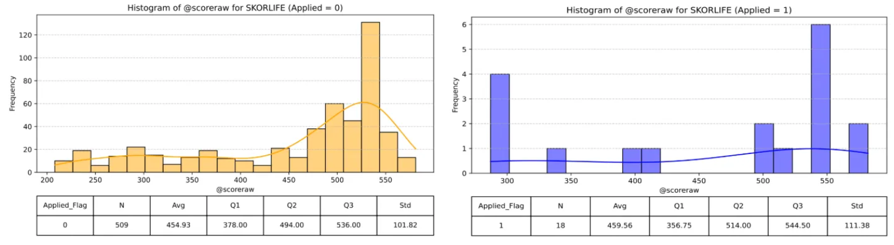

**D2C** (applied median 507 vs 504 for non-applied, so almost no difference):

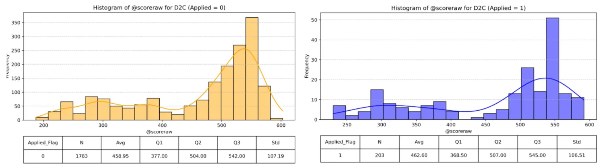

**Ciputra** has the best scores (applied median 541, N=4,832; non-applied median 532.5, N=630):

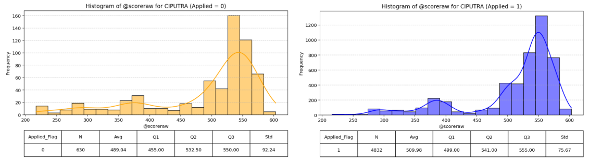

- Applicants score slightly higher than non-applicants in Skorlife and Ciputra, which suggests higher-score people are somewhat more likely to apply. In D2C the two groups are nearly identical.
- The spread (standard deviation) is about 100 points in every group, so the distributions overlap heavily.
- **Ciputra approval:** most Ciputra applicants are approved (4,183 of about 4,830 with a score), so the applied and approved charts look almost the same. Approved applicants have a median score of 542 and a lower quartile of 501, which is where the "approved customers score above 500" reading comes from.

### Approved vs rejected (Ciputra)

Among Ciputra applicants who did not get an approval, I split those the bank rejected from the others.

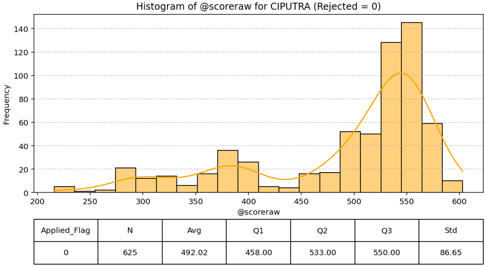
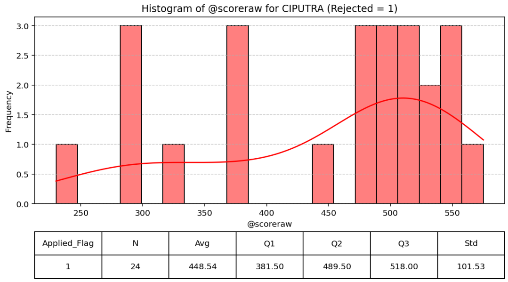

*(Left: not rejected. Right: rejected.)*

| | N | Mean | Median | Q1 | Q3 |
|---|---|---|---|---|---|
| Not rejected | 625 | 492.0 | 533.0 | 458 | 550 |
| Rejected | 24 | 448.5 | 489.5 | 381.5 | 518 |

The Notion write-up summarises this as "rejected customers typically have scores of 500 or below" (and, in the profiling summary, "centred around 400"). The chart supports the direction, since rejected customers score lower, but the spread is wide: the rejected group has a median of 489.5, a cluster of scores around 290 and 380, and several between 470 and 575. Only 24 customers were rejected, so this is a weak signal.

---

## 2. Age

Applicants are older than the general customer base in every channel.

| Channel | Non-applied median age | Applied median age |
|---|---|---|
| Skorlife | 27 | 35 |
| D2C | 34 | 38 |
| Ciputra | 35 | 37 |

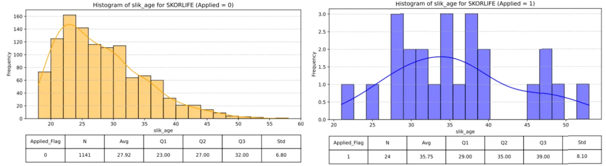
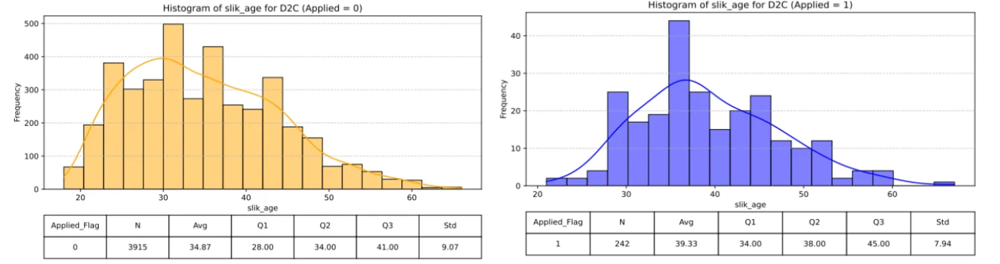

*(Left: Skorlife. Right: D2C. Orange is non-applied, blue is applied.)*

Julo is too small (18 non-applied, median 38.5; 1 applied, age 39).

- **Skorlife** has a young user base (most are in their 20s) but converts better in the 30+ segment.
- **D2C** has a more balanced age mix, with stronger applications from the 35 to 45 band.
- **Ciputra** applicants are concentrated between 30 and 50.

---

## 3. Credit footprint (recent credit activity)

Footprint counts how many credit enquiries or contracts a person had in the last 1, 3, 6 and 12 months.

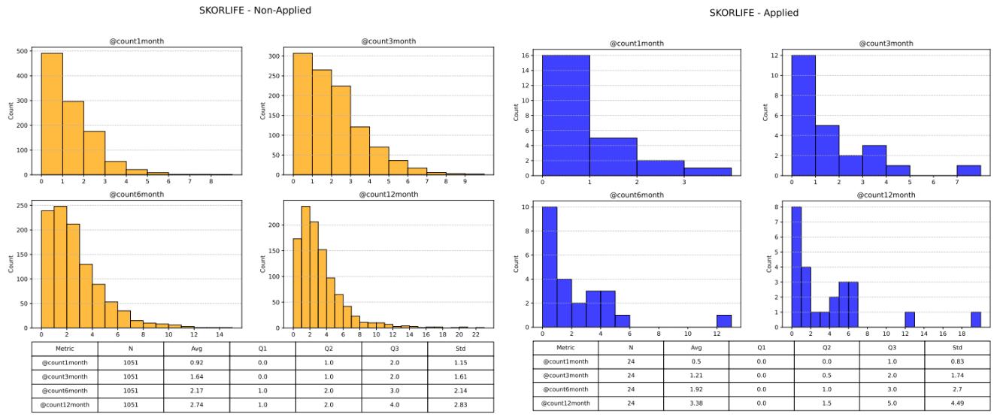
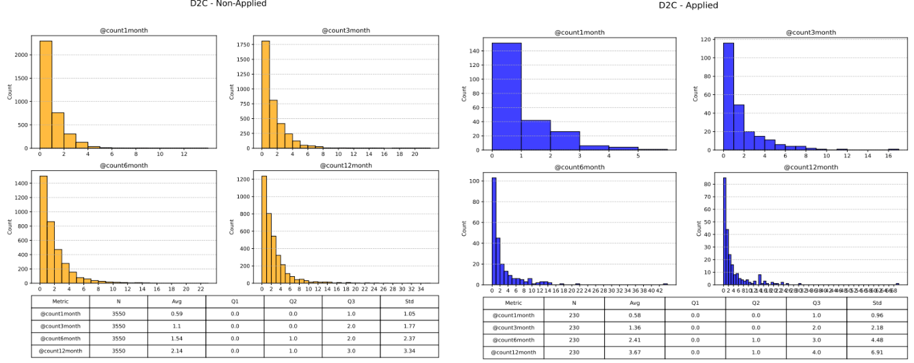

*(Left: Skorlife. Right: D2C. Non-applied on the left of each image, applied on the right.)*

| Average over the last 12 months | Non-applied | Applied |
|---|---|---|
| Skorlife | 2.74 | 3.38 |
| D2C | 2.14 | 3.67 |
| Ciputra | 1.07 | 0.60 |

- In Skorlife and D2C, applicants have somewhat higher recent credit activity.
- In Ciputra the pattern is reversed: applicants (and approved customers) have *lower* recent activity than non-applicants. Ciputra customers who were rejected show slightly higher 12-month activity (average 1.83, N=35) than approved ones (0.52), which fits the idea that rejected customers are actively seeking loans out of need.
- Julo customers show very high activity (average 10.3 over 12 months), but the sample is 18, so I would not draw conclusions from it.

---

## 4. Education, marital status, gender and occupation

**Education.** Bachelor's degree is the largest group among applicants in every channel, and the proportion of bachelor's degrees is much higher among applicants than non-applicants. Among non-applicants, "No degree" is the largest group in Skorlife and D2C.

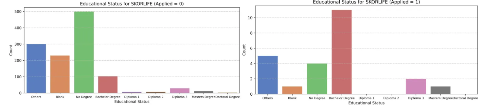
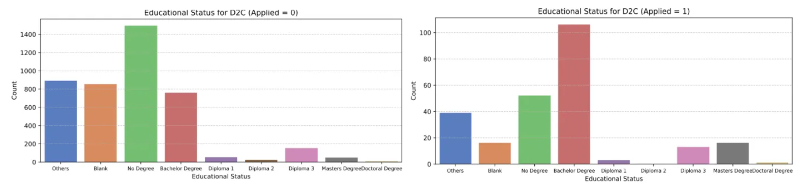
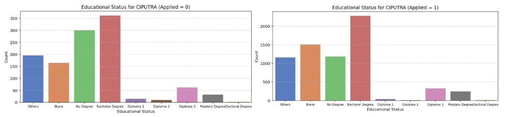

*(Education, applied vs non-applied: Skorlife, D2C, then Ciputra. In Ciputra, "Bachelor degree" is also the largest non-applied group, but the applied group has far more of it.)*

**Gender.** Men are the majority in every channel among applicants. Ciputra is the most balanced. Many records are blank (740 for Ciputra applicants).

| Applied | Male | Female |
|---|---|---|
| Ciputra | 4,230 | 3,574 |
| D2C | 251 | 71 |
| Skorlife | 21 | 5 |

**Marital status.** For Ciputra and Skorlife, among records with a status, singles outnumber married people in both groups (Ciputra applicants: 2,256 single vs 1,674 married; Skorlife applicants: 16 vs 6). In D2C, non-applicants are mostly single (2,574 vs 1,906 married), while applicants are split almost evenly between married (130) and single (123). A large share of records are blank, especially for Ciputra (4,511 of the applicants).

**Occupation.** Most records are blank or "others", so this is a weak signal. Among the occupations that are recorded, **entrepreneurs** stand out among applicants in every channel (Ciputra 14.4%, D2C 19.9%, Skorlife 26.9%, against 5% to 10% of non-applicants), followed by general administration and executives.

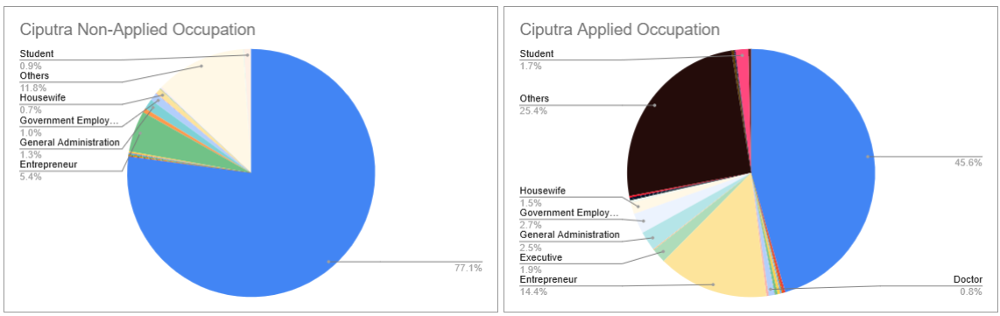

*(Ciputra occupation. 45.6% of applicants and 77.1% of non-applicants have a blank occupation.)*

---

## 5. Where customers live

Applicants come disproportionately from **Jakarta and West Java**. Among non-applicants, the cities are a wide mix, with Bandung and blank values the largest named groups at 4% to 11%.

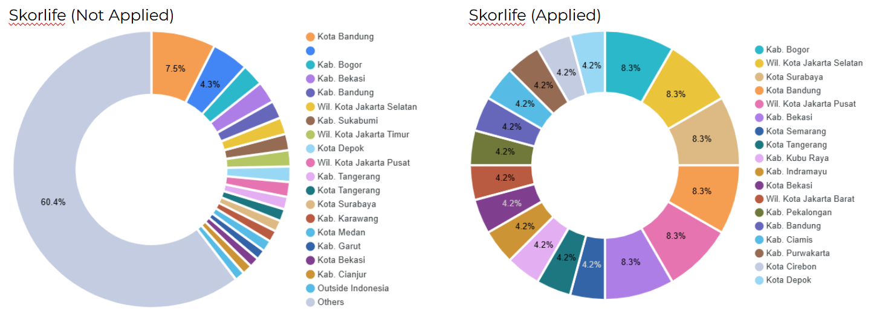
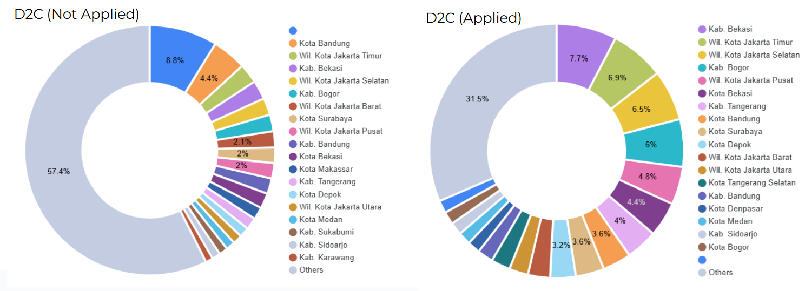

*(City of non-applied vs applied customers: Skorlife on the left, D2C on the right.)*

The top applicant cities in D2C are Kab. Bekasi (7.7%), Jakarta Timur (6.9%), Jakarta Selatan (6.5%), Kab. Bogor (6.0%) and Jakarta Pusat (4.8%). In Skorlife the applicant group is only 24 people, so each city is two people (8.3%).

---

## 6. Credit limit, approved plafond and contract history

### Applicants have much larger credit limits

Median total credit limit, non-applied vs applied:

| Channel | Non-applied | Applied |
|---|---|---|
| Ciputra | Rp 89M | Rp 245M |
| D2C | Rp 32.6M | Rp 670M |
| Skorlife | Rp 5.6M | Rp 616M |

The lower quartile of applicants' limits is Rp 181M for D2C and Rp 275M for Skorlife, so almost every applicant in those two channels has a limit above about Rp 175M, whereas a large share of non-applicants sit at or near zero. This is the largest separation I found between the groups.

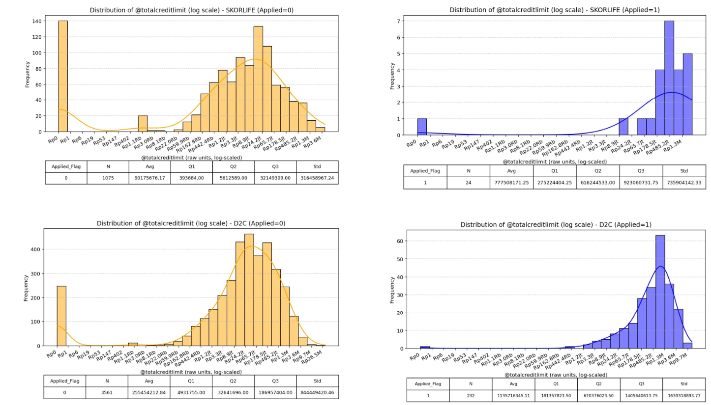

### Credit limit rises with age; approved plafond flattens

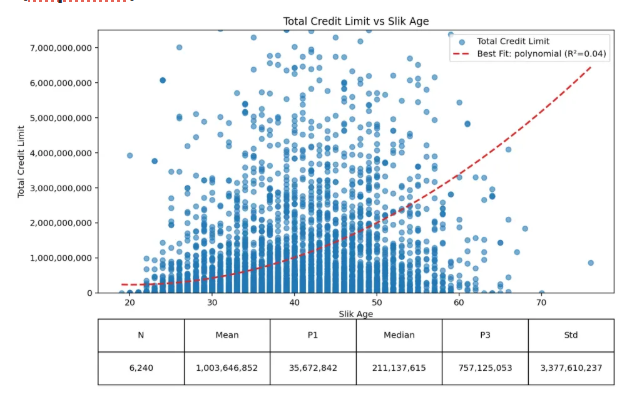
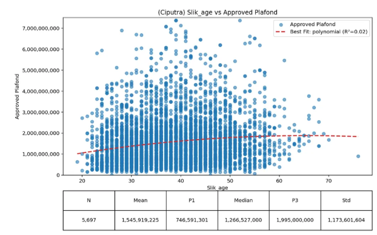

*(Ciputra. Left: total credit limit vs age. Right: approved plafond vs age.)*

- **Ciputra:** credit limit rises steeply with age, especially after 40. There is a huge gap between the mean (about Rp 1.0 billion) and the median (Rp 211 million), because a small group holds very large limits and most people cluster far lower. Approved plafond, by contrast, **flattens at roughly Rp 1.8 to 2 billion for ages above 50** (N=5,697, median Rp 1.27 billion, upper quartile Rp 1.995 billion).
- **Weak fit:** the polynomial trend lines on these scatter plots have R² of only 0.02 to 0.04, so age explains very little of the variation in limit or plafond. The shape is a tendency, not a rule.
- **Who approves:** most Ciputra approvals come from BCA (1,928), BNI (672) and Mandiri (601). These large banks appear to cap plafond around Rp 2 billion even for older, high-limit customers.

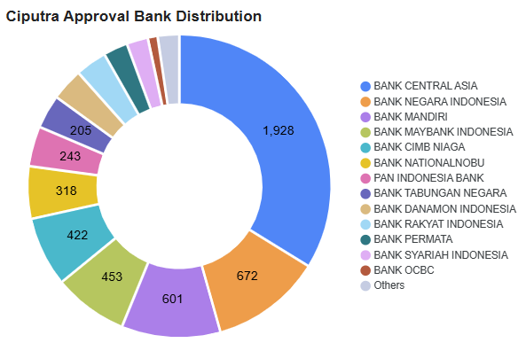

- **Skorlife:** a flatter rise in credit limit with age (median Rp 6.1 million), which suggests a less wealthy population. Only 3 approvals exist, all below Rp 1 billion (CIMB, Permata, Mandiri).
- **D2C:** richer than Skorlife (median credit limit Rp 38.7 million), but well below Ciputra. Approved plafond (N=49, median Rp 704 million) peaks around age 35 to 40 and **falls with age**. Approvals come mostly from CIMB Niaga (12), BSI (12) and KB (6).

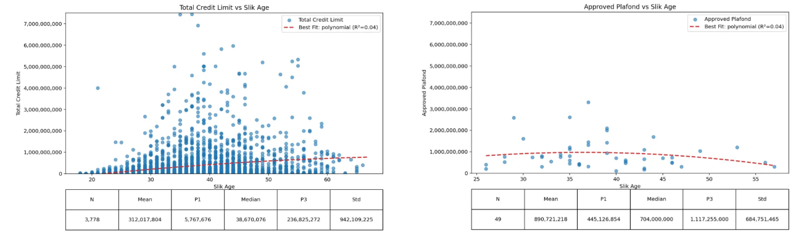

**Reading:** the small and mid-sized banks seen in Skorlife and D2C look more conservative on plafond than the large banks seen in Ciputra. This is an inference from approval counts by bank, not a tested result.

### Closed and active contracts

In Skorlife and D2C, people who applied have more **closed contracts** (finished credits) and more **active contracts** than those who didn't, which fits the idea that they are experienced borrowers who are likely to take a new contract.

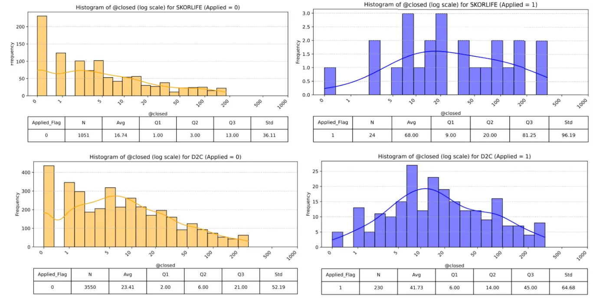

| Median contracts | Non-applied | Applied |
|---|---|---|
| Closed, Skorlife | 3 | 20 |
| Closed, D2C | 6 | 14 |
| Active, Skorlife | 2 | 11.5 |
| Active, D2C | 3 | 9 |

**Ciputra is different.** Ciputra applicants have a *lower* median closed-contract count than non-applicants (6 vs 13), and approved customers have a lower median than those not approved (5 vs 9). Active contracts are the same in both groups (median 4). The Notion write-up states the "applicants have more closed contracts" finding as general; the Ciputra charts do not support it.

### Overdue amounts

Most people in every group have no overdue amount. At Ciputra roughly three quarters of applicants (about 3,850 of 5,251) have none, against less than half of non-applicants (about 470 of 982). For D2C the gap is smaller (about 52% of applicants vs 38% of non-applicants at zero). This was not discussed in the Notion write-up.

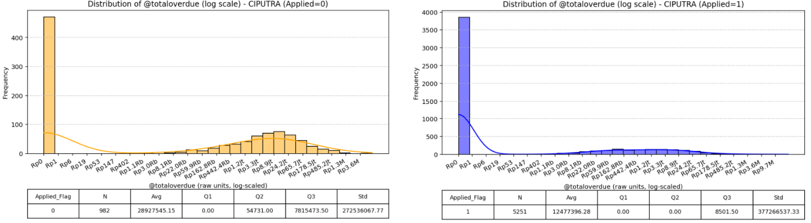

*(Ciputra total overdue, non-applied vs applied, log scale.)*

Across all channels, a higher credit limit goes with more closed contracts (positive trend lines on the scatter plots), which is the basis of the Notion page's "high limit means more completed contracts" reading.

---

## 7. What this adds up to

The Notion write-up summarises the profile of a customer likely to apply:

- Age **30 to 50**, with the strongest conversion from 35 to 45 in D2C
- Higher education (bachelor's degree)
- Higher credit limit and more closed contracts
- Located in **Jakarta or West Java**

By channel:

| Channel | Profile |
|---|---|
| Ciputra | The wealthiest and the best credit; high credit limits, but approved plafond is capped by conservative large banks |
| D2C | A middle-class profile with the highest scores among the non-developer channels |
| Skorlife | Young base with moderate capacity; converts best at 30+ |
| Julo | Older, high credit activity; too small to judge |

### A practical use: finding cities to target

Using the finding that applicants have high credit limits (above roughly Rp 175M) and are concentrated in Jakarta and West Java, I looked for cities with **high average credit limit, high user volume and low conversion**, which are the places where conversion could most easily be raised.

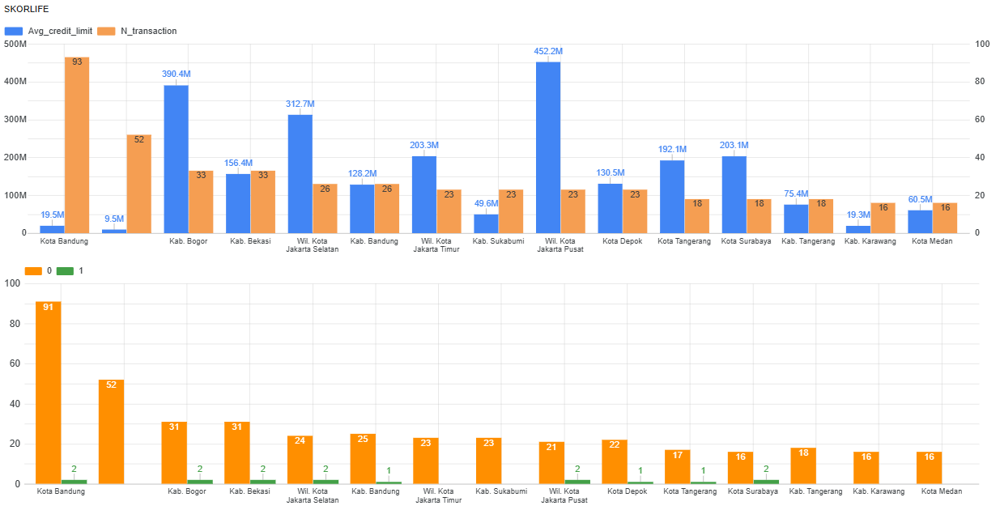

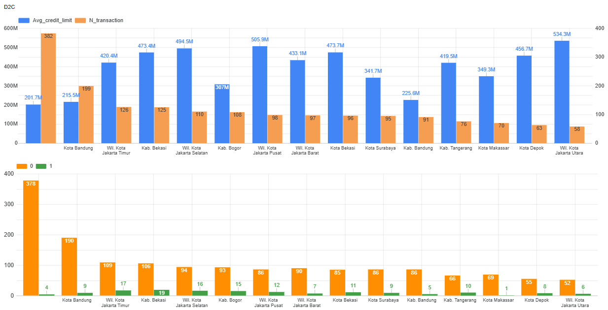

*(Skorlife and D2C. Top: average credit limit in blue, transaction count in orange. Bottom: non-applied in orange, applied in green.)*

The cities that pass the filter, and the number of non-applied users in each (the "potential users"), match the charts:

- **Skorlife:** Jakarta Pusat (21; average limit Rp 452M, 2 applied), Kab. Bogor (31; Rp 390M, 2 applied), Jakarta Selatan (24; Rp 313M, 2 applied)
- **D2C:** Jakarta Pusat (86; Rp 506M, 12 applied), Jakarta Selatan (94; Rp 495M, 16 applied), Kab. and Kota Bekasi (191 combined; about Rp 473M, 19 and 11 applied), Jakarta Timur (109; Rp 420M, 17 applied)

In every one of these cities, only about 6% to 15% of users in the sample have applied.

---

## 8. From profile to tiering

A short working note takes this profile one step further, listing the parameters that could be used to tier customers. Fields struck through on the page were dropped; the ones kept are grouped into two ideas:

- **Risk:** credit score (with an error code instead of just a blank), and collectability (worst KOL over all time, by credit type, by amount, and by days past due)
- **Capacity:** the active SLIK credit limit (as a multiple of income), asset ownership (active and inactive), initial KPR plafond, income range, credit amount and stated income

The meeting notes on the page also record a prioritisation rule: **look at capacity first**, because there is no point in a low-risk customer who cannot afford the credit. They also separate "segmentation" (a customer attribute) from "tiering", and "addressability" from "convertibility".

---

## What I took away

- **No single attribute defines a good customer.** The credit score distributions of applicants and non-applicants overlap heavily (standard deviation about 100 points), so the profile is a combination: age, education, capacity, location and contract history.
- **The channel matters as much as the person.** Ciputra customers are wealthier and have better credit than D2C or Skorlife, so the same score means different things in different channels.
- **Bank behaviour caps outcomes.** Large banks approve bigger plafonds (up to about Rp 2 billion) and smaller banks stay below Rp 1 billion, so a customer's "capacity" is limited by who approves them.
- **Small samples limit many findings.** Skorlife (24 applicants) and Julo (1) cannot support firm conclusions, and Ciputra's rejected group is 24 customers.

<!-- NOTE: all numbers above were checked against the charts. Charts not embedded here but viewed: EDA Julo and active-contract panels, debit-balance panels, age-vs-score scatter plots (no visible relationship between age and score in any channel). -->
